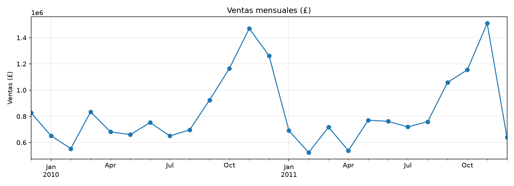
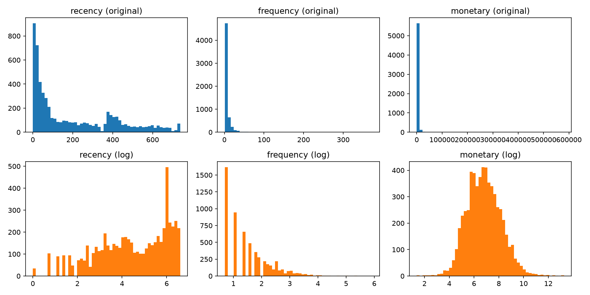
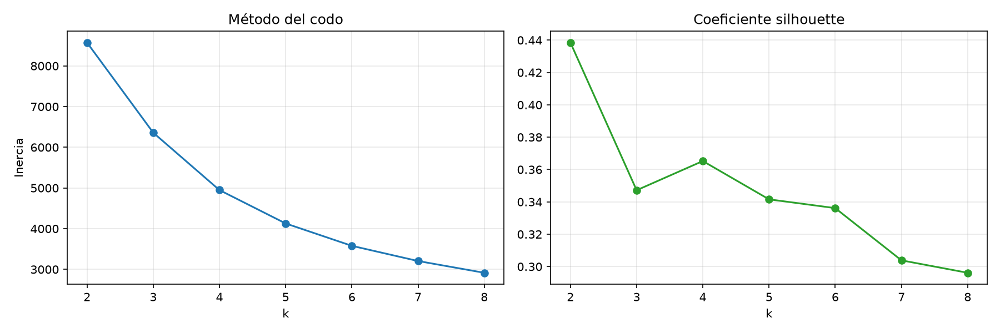
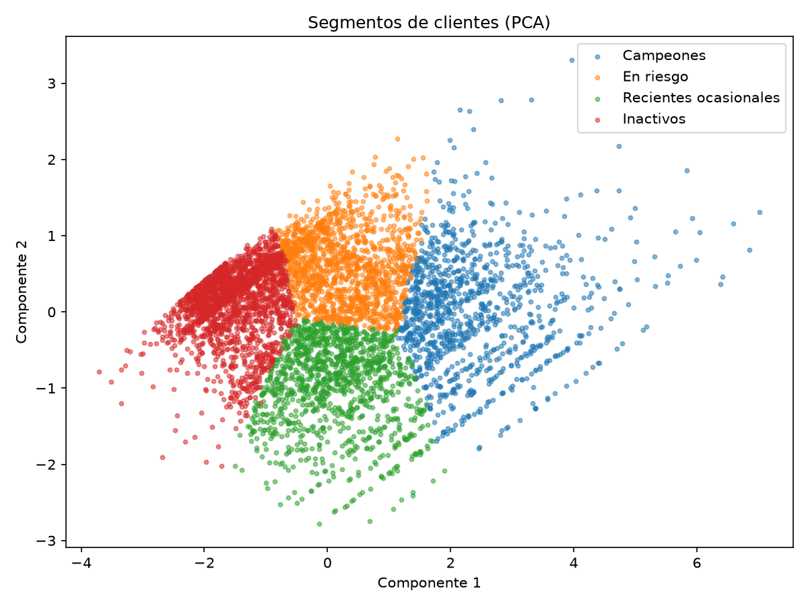
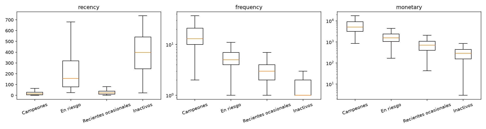

# Segmentación de clientes de un retailer en línea (RFM + K-Means)

Proyecto de minería de datos siguiendo la metodología CRISP-DM: ETL con SQL (SQLite), segmentación de clientes con RFM y K-Means, reglas de asociación entre productos y despliegue en Streamlit.

**App en línea:** [segmentacion-clientes-guribe.streamlit.app](https://segmentacion-clientes-guribe.streamlit.app)

## Resultados principales

- Se identificaron **4 segmentos de clientes**. Los **Campeones** son el 19 % de los clientes y generan el **71.6 % de las ventas**.
- El segmento **En riesgo** (25 % de los clientes, 18.5 % de las ventas) agrupa a buenos clientes que llevan unos 5 meses sin comprar: es la principal oportunidad de reactivación.
- Las ventas tienen una **estacionalidad marcada**, con un pico en noviembre por la campaña navideña.
- Los clientes **compran colecciones**: las reglas de asociación relacionan el mismo artículo en distintos diseños, con un lift de entre 5 y 14.
- El **15.4 % de las ventas** no tiene cliente identificado y no puede segmentarse.

## Metodología (CRISP-DM)

| Fase | Archivo |
|---|---|
| 1. Comprensión del negocio | Este README |
| 2. Comprensión de los datos | [`notebooks/01_exploracion.ipynb`](notebooks/01_exploracion.ipynb) |
| 3. Preparación de los datos | [`notebooks/02_preparacion.ipynb`](notebooks/02_preparacion.ipynb) y [`sql/`](sql/) |
| 4. Modelado | [`notebooks/03_segmentacion.ipynb`](notebooks/03_segmentacion.ipynb) y [`notebooks/04_reglas_asociacion.ipynb`](notebooks/04_reglas_asociacion.ipynb) |
| 5. Evaluación | [`notebooks/03_segmentacion.ipynb`](notebooks/03_segmentacion.ipynb) (perfiles y criterios de éxito) |
| 6. Despliegue | [`app.py`](app.py) (Streamlit) |

## 1. Comprensión del negocio

**Contexto.** Retailer en línea del Reino Unido que vende artículos de regalo; muchos de sus clientes son mayoristas. Se dispone de sus transacciones entre diciembre de 2009 y diciembre de 2011.

**Problema.** La empresa no distingue entre sus clientes: no sabe cuáles son los más valiosos, cuáles compran de forma ocasional ni cuáles están dejando de comprar. Sin esa información, las acciones comerciales son las mismas para todos.

**Objetivo de negocio.** Identificar grupos de clientes con un comportamiento de compra similar para orientar acciones diferenciadas de fidelización, reactivación y retención.

**Preguntas de negocio**
- ¿Qué grupos de clientes existen según qué tan reciente, frecuente y alto es su gasto?
- ¿Qué parte de las ventas concentra cada grupo?
- ¿Qué clientes valiosos muestran señales de abandono?
- ¿Qué acción comercial conviene para cada grupo?

**Objetivo de minería de datos.** Segmentar a los clientes con un modelo no supervisado (K-Means) a partir de tres variables RFM: Recency (días desde la última compra), Frequency (número de compras) y Monetary (gasto total).

**Criterios de éxito**
- Negocio: segmentos interpretables, cada uno con una acción comercial concreta, y en un número manejable para un equipo de marketing (entre 3 y 6).
- Técnico: elegir el número de segmentos con el método del codo y el coeficiente silhouette, priorizando la interpretabilidad cuando ambos criterios no coincidan.

**Supuestos y limitaciones**
- Solo pueden segmentarse los clientes identificados; las ventas sin `Customer ID` (15.4 % del monto) quedan fuera.
- Monetary mide ingresos, no rentabilidad: el dataset no incluye costos ni márgenes.
- No hay datos demográficos; la segmentación se basa solo en el comportamiento de compra.
- Los datos terminan en diciembre de 2011; el análisis muestra el método, no la situación actual de la empresa.

## 2. Comprensión de los datos

- 1,067,371 filas (una por producto en cada factura), 8 columnas, 5,942 clientes y 43 países.
- El Reino Unido concentra el 85 % de las ventas.
- Problemas encontrados: filas sin `Customer ID`, facturas canceladas, cantidades y precios negativos o en cero, filas duplicadas y códigos que no son productos (envíos, comisiones, ajustes).



## 3. Preparación de los datos

El CSV se cargó completo a SQLite (`transacciones_raw`) sin modificarlo. Con SQL ([`01_limpieza.sql`](sql/01_limpieza.sql)) se construyeron tablas filtradas para el análisis:

| Criterio | Filas afectadas | Decisión |
|---|---|---|
| Sin `Customer ID` | 243,007 (≈23 %) | Se excluyen: no pueden asignarse a un cliente. Representan el 15.4 % del monto vendido. |
| Facturas canceladas (prefijo C) | 19,494 | No cuentan como compras; se usan para calcular la tasa de devolución. |
| Cantidad ≤ 0 o precio ≤ 0 | 22,950 / 6,207 | Se excluyen: devoluciones, ajustes o regalos. |
| Filas duplicadas exactas | 34,335 | Se excluyen (supuesto: errores de registro). |
| Códigos que no son productos | — | Se excluyen para medir solo el gasto en productos. |

Resultado: `ventas_limpias` con 776,579 filas, 5,852 clientes y £17.07 M. Al quitar duplicados y cargos que no son productos, el monto con cliente baja un 3.8 %.

Con [`02_rfm.sql`](sql/02_rfm.sql) se calculó una fila por cliente con Recency, Frequency, Monetary y tasa de devolución. La fecha de referencia es el 10/12/2011, el día siguiente a la última venta. Los valores extremos no se eliminaron, porque probablemente son clientes mayoristas; se trataron con una transformación logarítmica.

## 4. Modelado

**Segmentación.** Las variables RFM se transformaron con `log1p` y se estandarizaron (`StandardScaler`). Se probó K-Means con k de 2 a 8.





Se eligió **k = 4**. El silhouette más alto es el de k = 2 (0.438), pero dos grupos no permiten acciones diferenciadas. Dentro del rango de negocio (3 a 6), k = 4 tiene el mejor silhouette (0.365) y coincide con el codo de la inercia.

**Reglas de asociación.** Se aplicó FP-Growth (`mlxtend`) a las facturas del Reino Unido, con soporte mínimo de 2 %, confianza ≥ 50 % y lift ≥ 1.5.

## 5. Evaluación: segmentos y recomendaciones

| Segmento | % clientes | % ventas | Perfil (medianas) | Acción recomendada |
|---|---|---|---|---|
| Campeones | 19.0 % | 71.6 % | Última compra hace 15 días, 13 compras, £5,118 | Programa de fidelización, acceso anticipado a la campaña navideña y atención preferente. |
| En riesgo | 25.1 % | 18.5 % | Hace 157 días, 5 compras, £1,580 | Campaña de reactivación antes de la temporada alta, con ofertas basadas en sus compras anteriores. |
| Recientes ocasionales | 20.8 % | 5.9 % | Hace 23 días, 3 compras, £708 | Incentivar la siguiente compra con recomendaciones de productos y envío gratis desde cierto monto. |
| Inactivos | 35.1 % | 4.1 % | Hace 398 días, 1 compra, £291 | Acciones de bajo costo (correo masivo) y medir la respuesta antes de invertir más. |





- La separación entre segmentos es moderada (silhouette 0.365), algo habitual en datos de comportamiento de clientes.
- La tasa de devolución es similar en todos los segmentos (2–3 %), por lo que no los diferencia.
- **Reglas de asociación:** se obtuvieron 14 reglas. La mayoría relaciona el mismo artículo en distintos diseños, y el diseño "Red Retrospot" es el producto ancla (consecuente en 8 de las 14 reglas). Esto permite recomendar los otros diseños de una colección a los "Recientes ocasionales" y ofrecer packs de colección a los clientes "En riesgo".
- Las recomendaciones son propuestas a validar; su efecto debería medirse con pruebas (por ejemplo, un grupo de control).

## 6. Despliegue

App en Streamlit con tres secciones:
- **Resumen del negocio:** KPIs, ventas mensuales y principales países.
- **Segmentos:** tamaño, perfil y acción recomendada para cada segmento; búsqueda del segmento de un cliente por su ID; y clasificación de un cliente nuevo con el modelo entrenado.
- **Productos que se compran juntos:** reglas de asociación con filtros.

## Trabajo futuro

- **Pronóstico de ventas:** la estacionalidad marcada lo justifica, aunque con solo 24 meses (2 ciclos) se limita a modelos simples.
- **Predicción de abandono (churn):** el segmento "En riesgo" sugiere anticipar qué clientes dejarán de comprar, entrenando con un período y validando con el siguiente.

## Estructura del repositorio

```
├── app.py                      # App de Streamlit
├── requirements.txt            # Librerías de la app
├── data/
│   ├── raw/                    # CSV original (no incluido, ver Dataset)
│   └── processed/              # Resultados en CSV (RFM, segmentos, reglas, resúmenes)
├── models/                     # Modelo K-Means y scaler entrenados
├── notebooks/                  # 01 exploración · 02 preparación · 03 segmentación · 04 reglas
├── reports/figuras/            # Gráficos
└── sql/                        # Scripts de limpieza y cálculo de RFM
```

## Dataset

[Online Retail II (UCI)](https://www.kaggle.com/datasets/mashlyn/online-retail-ii-uci), publicado en Kaggle con licencia CC0 (dominio público). El archivo no se incluye en el repositorio por su tamaño.

## Cómo reproducirlo

```bash
git clone https://github.com/Guille2977/segmentacion-clientes-retail.git
cd segmentacion-clientes-retail
py -m venv venv
venv\Scripts\activate
pip install -r requirements.txt
pip install matplotlib mlxtend jupyter
```

1. Descarga el dataset y guárdalo como `data/raw/online_retail_II.csv`.
2. Ejecuta los notebooks en orden (01 → 04). El 02 genera la base `data/processed/retail.db`.
3. Inicia la app con `streamlit run app.py`.

## Tecnologías

Python 3.13 · pandas · NumPy · SQLite (SQL) · scikit-learn · mlxtend · Matplotlib · Streamlit · Altair · Git/GitHub

## Autor

Guillermo César Uribe Mejía · [LinkedIn](https://www.linkedin.com/in/guillermo-uribe) · [GitHub](https://github.com/Guille2977)